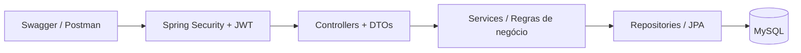
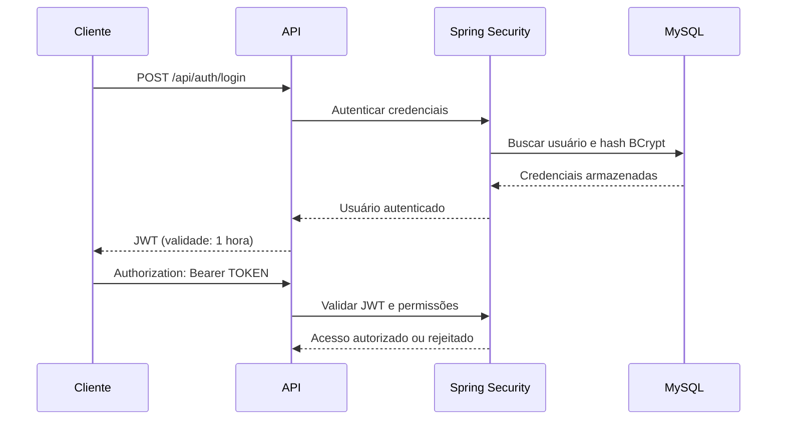

<div align="center">
  
</div>

<div align="center">
    
# S A N Q U I M　//　S C H O O L　A P I

### `JAVA • SPRING BOOT • REST API • SECURITY • MYSQL`

**API REST de gestão escolar com controle de acesso por perfil, diário de classe e consultas privadas.**


`PROJETO ACADÊMICO` · `BACKEND` · `FATEC`

[Visão geral](#visao-geral) · [Arquitetura](#arquitetura) · [API](#api) · [Segurança](#seguranca) · [Execução](#execucao) · [Testes](#testes) · [Equipe](#equipe)

</div>

---

<a id="visao-geral"></a>

## `SANQUIM // VISÃO GERAL`

O **Colégio Sanquim** é uma API REST desenvolvida em **Java e Spring Boot** para organizar processos administrativos e pedagógicos de uma instituição de ensino.

A Gestão cadastra pessoas, turmas, disciplinas e vínculos. Professores registram chamadas, avaliações, notas e planos de aula nas turmas às quais estão atribuídos. Alunos consultam seus próprios boletins, frequência e conteúdos das aulas.

O escopo atual é **backend**: a API é documentada pelo Swagger/OpenAPI e pode ser demonstrada pelo Postman. Não há frontend escolar próprio nesta versão.

| Indicador | Implementação |
| :--- | :--- |
| Entidades de domínio | `13` |
| Operações de negócio | `23` |
| Perfis de acesso | `GESTÃO` · `PROFESSOR` · `ALUNO` |
| Persistência principal | `MySQL` |
| Testes automatizados | `JUnit / Spring Test / H2` e cenários opcionais com MySQL |

## `SYSTEM // STATUS`

| Módulo | Estado no código |
| :--- | :---: |
| Autenticação com JWT | `● IMPLEMENTADO` |
| Controle de acesso por perfil | `● IMPLEMENTADO` |
| Cadastros administrativos | `● IMPLEMENTADO` |
| Matrículas e atribuições docentes | `● IMPLEMENTADO` |
| Diário de classe e frequências | `● IMPLEMENTADO` |
| Avaliações, notas e médias | `● IMPLEMENTADO` |
| Consultas privadas dos alunos | `● IMPLEMENTADO` |
| Swagger e coleção Postman | `● DISPONÍVEIS` |
| Frontend escolar | `○ FORA DO ESCOPO` |

> **STATUS:** implementação documentada no repositório. A execução e os testes dependem da configuração local do Java e do banco de dados. O guia técnico registra uma execução anterior com 100 testes aprovados; esse resultado não substitui uma nova execução na sua máquina.

<a id="arquitetura"></a>

## `ARCHITECTURE // FLUXO DA APLICAÇÃO`



| Camada | Responsabilidade |
| :--- | :--- |
| `controller` | Receber requisições HTTP e entregar respostas |
| `dto` | Definir e validar os contratos de entrada e saída |
| `service` | Aplicar regras de negócio e transações |
| `repository` | Persistir e consultar dados com Spring Data JPA |
| `entity` | Mapear entidades e relacionamentos do domínio |
| `security` | Autenticação, JWT e limites de login |
| `config` | Configurações de segurança, Swagger e carga inicial |
| `exception / validation` | Tratar erros e validar regras específicas |

## `ACCESS CORE // PERFIS E PERMISSÕES`

| Perfil | Ações autorizadas |
| :--- | :--- |
| `ROLE_GESTAO` | Cadastros administrativos e lançamentos no Diário de turmas ativas |
| `ROLE_PROFESSOR` | Diário somente nas turmas e disciplinas atribuídas |
| `ROLE_ALUNO` | Consulta privada do próprio boletim, frequência e aulas |

**Autenticação não é autorização:** entrar no sistema não significa poder acessar todos os recursos. A verificação ocorre tanto nas rotas quanto nas regras do serviço.

<a id="api"></a>

## `API CORE // ENDPOINTS`

### Autenticação

| Método | Endpoint | Função |
| :---: | :--- | :--- |
| `POST` | `/api/auth/login` | Autenticar e emitir JWT |

### Gestão — `ROLE_GESTAO`

Os recursos abaixo oferecem `POST` para cadastro e `GET` para listagem, sob o prefixo `/api/admin`.

| Recurso | Caminho |
| :--- | :--- |
| Gestores | `/gestores` |
| Professores | `/professores` |
| Alunos | `/alunos` |
| Turmas | `/turmas` |
| Disciplinas | `/disciplinas` |
| Matrículas | `/matriculas` |
| Atribuições docentes | `/atribuicoes` |

As listagens são paginadas, começando em `page=0`, com `size=20` por padrão e limite máximo de `100`.

### Diário — `ROLE_GESTAO` ou `ROLE_PROFESSOR`

| Método | Endpoint | Função |
| :---: | :--- | :--- |
| `GET` | `/api/diario/minhas-turmas` | Listar atribuições do professor autenticado |
| `POST` | `/api/diario/chamada` | Registrar chamada completa |
| `POST` | `/api/diario/avaliacoes` | Cadastrar avaliação |
| `POST` | `/api/diario/avaliacoes/{avaliacaoId}/notas` | Criar ou atualizar nota |
| `POST` | `/api/diario/planos-aula` | Registrar plano de aula |

### Aluno — `ROLE_ALUNO`

| Método | Endpoint | Função |
| :---: | :--- | :--- |
| `GET` | `/api/aluno/boletim` | Notas e médias parciais |
| `GET` | `/api/aluno/frequencia` | Presenças, faltas e percentuais |
| `GET` | `/api/aluno/aulas` | Conteúdos de aulas disponíveis |

O serviço identifica o aluno pelo token autenticado. O cliente não fornece livremente um ID para consultar os dados de outra pessoa.

<a id="seguranca"></a>

## `SECURITY CORE // AUTENTICAÇÃO E PROTEÇÃO`



- **BCrypt:** armazena hash das senhas, não senhas em texto puro.
- **JWT/HMAC256:** assina os tokens e permite verificar sua integridade.
- **RBAC:** restringe o acesso com base no perfil.
- **Verificação de vínculo:** professor só manipula turma e disciplina atribuídas.
- **Rate limit de login:** limita tentativas por e-mail e IP.
- **DTOs e Bean Validation:** validam entradas e evitam expor atributos internos nas respostas.
- **Transações e restrições de banco:** protegem a integridade em operações relacionadas e concorrentes.

### Respostas HTTP frequentes

| Código | Significado |
| :---: | :--- |
| `200 / 201` | Sucesso / recurso criado |
| `400` | Dados inválidos |
| `401` | Falta de autenticação ou credenciais inválidas |
| `403` | Permissão insuficiente |
| `404` | Recurso não encontrado |
| `409` | Conflito ou duplicidade |
| `429` | Limite de tentativas de login |

## `DIARIO CORE // REGRAS DE NEGÓCIO`

**Chamada completa:** o lançamento deve incluir todos os alunos com matrícula ativa na turma. O sistema impede registros repetidos para a mesma turma, disciplina e data.

**Avaliações e notas:** a nota precisa respeitar o limite da avaliação; registros existentes são atualizados sem criar outra nota para a mesma combinação de aluno e avaliação.

**Média parcial:** notas são normalizadas para escala de 0 a 10 e ponderadas pelos respectivos pesos. Uma avaliação sem nota lançada não é tratada como zero.

**Precisão:** operações sobre notas e médias utilizam `BigDecimal`.

## `TECH // STACK`

| Backend | Segurança | Dados e ferramentas |
| :--- | :--- | :--- |
| Java 17 | Spring Security | MySQL |
| Spring Boot 4.1.2 | JWT (`java-jwt`) | Spring Data JPA / Hibernate |
| Spring Web MVC | BCrypt | H2 (testes) |
| Jakarta Validation | RBAC | Flyway (perfil prod) |
| Maven | Validação de entrada | Swagger / OpenAPI / Postman |
| Lombok | Controle de tentativas de login | JUnit / Spring Test |

## `STRUCTURE // ORGANIZAÇÃO DO REPOSITÓRIO`

```text
ProjetoSanquim/
├── src/
│   ├── main/
│   │   ├── java/com/lab/projetosanquim/
│   │   │   ├── config/
│   │   │   ├── controller/
│   │   │   ├── dto/
│   │   │   ├── entity/
│   │   │   ├── exception/
│   │   │   ├── repository/
│   │   │   ├── security/
│   │   │   ├── service/
│   │   │   └── validation/
│   │   └── resources/
│   │       ├── application.properties
│   │       ├── application-prod.properties
│   │       └── db/migration/
│   │           ├── V1__esquema_inicial.sql
│   │           └── V2__diario_classe.sql
│   └── test/java/com/lab/projetosanquim/
├── Sanquim-Login.postman_collection.json
├── pom.xml
├── mvnw
├── mvnw.cmd
└── README.md
```

<a id="configuracao"></a>

## `DATABASE CONFIG // MYSQL`

**Pré-requisitos:** JDK 17 ou 21, MySQL e acesso às dependências Maven.

Crie o banco de desenvolvimento:

```sql
CREATE DATABASE IF NOT EXISTS sanquim CHARACTER SET utf8mb4;
```

A configuração padrão espera um usuário MySQL chamado `sanquim_app`, com acesso ao banco `sanquim`. Crie ou ajuste esse usuário conforme sua instalação e configure a senha como variável de ambiente:

```bash
export SPRING_DATASOURCE_PASSWORD='sua_senha_local'
```

Em desenvolvimento, `application.properties` usa `spring.jpa.hibernate.ddl-auto=update`. No perfil `prod`, o esquema é controlado por migrações **Flyway** e validado pelo Hibernate. A chave de JWT (`SANQUIM_JWT_SECRET`) é obrigatória em produção.

> **SEGURANÇA:** não publique senhas reais ou chaves de assinatura no repositório. A configuração de demonstração não deve ser habilitada em produção.

<a id="execucao"></a>

## `BOOT SEQUENCE // EXECUÇÃO LOCAL`

No Terminal:

```bash
git clone https://github.com/victormourahs/ProjetoSanquim.git
cd ProjetoSanquim
chmod +x mvnw
./mvnw spring-boot:run
```

Com a API em execução, acesse o Swagger:

**http://localhost:8080/swagger-ui.html**

Para habilitar a carga opcional de demonstração em desenvolvimento, configure `SANQUIM_DEMO_SEED=true` e `SANQUIM_DEMO_PASSWORD` antes de iniciar a aplicação. Consulte o [README original do projeto](https://github.com/victormourahs/ProjetoSanquim) para os detalhes do ambiente e da coleção Postman.

<a id="testes"></a>

## `DIAGNOSTICS // TESTES`

A suíte inclui cenários de autenticação, autorização, cadastros, duplicidades, transações, chamada completa, lançamento de notas, média, frequência e concorrência.

Execute os testes com:

```bash
./mvnw test
```

Para executar apenas o cenário principal de integração escolar:

```bash
./mvnw -Dtest=FluxoEscolarTests test
```

Os cenários opcionais com MySQL exigem configuração de ambiente específica. **Não confunda testes aprovados anteriormente com uma nova execução desta versão.**

## `SCOPE // LIMITES E EVOLUÇÕES`

- O projeto atual é uma **API REST**, não uma aplicação com frontend próprio.
- Os cadastros administrativos não implementam edição e exclusão genéricas para todos os recursos.
- JWT não possui revogação ou refresh token implementados nesta versão.
- Evoluções possíveis incluem frontend, recuperação de senha, auditoria e novos fluxos administrativos.

---

<a id="equipe"></a>

## `TEAM // PARTICIPANTES DO PROJETO`

| Participante | GitHub |
| :--- | :--- |
| **Gilberto Corrêa** | [@gilbertocorrea-cmd](https://github.com/gilbertocorrea-cmd) |
| **Victor Moura** | [@victormourahs](https://github.com/victormourahs) |
| **Thiago Catozzi** | [@Cattozzi](https://github.com/Cattozzi) |
| **Pedro Machado** | [@Pedrophobia](https://github.com/Pedrophobia) |
| **Pedro Stefanin** | [@P3dr06](https://github.com/P3dr06) |

> **EQUIPE:** integrantes informados para o projeto.

---

<div align="center">

## `SANQUIM // BACKEND SYSTEM`

**Equipe Projeto Sanquim**


Projeto acadêmico — Análise e Desenvolvimento de Sistemas

FATEC

[Repositório original](https://github.com/victormourahs/ProjetoSanquim)

`JAVA` • `SPRING BOOT` • `JWT` • `MYSQL` • `REST API`

**● API IMPLEMENTADA · PRONTA PARA EXECUÇÃO E VALIDAÇÃO LOCAL**

</div>
